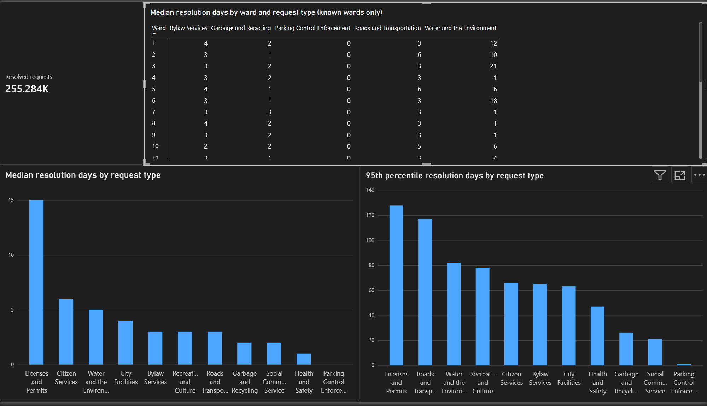
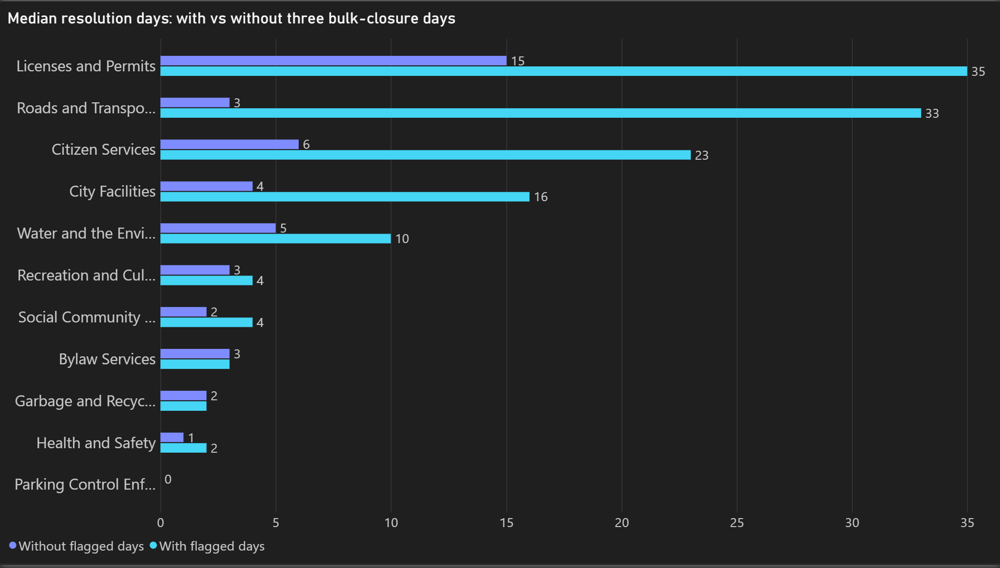

# Ottawa 311 Service Request Analysis

This Python and Power BI project examines how long City of Ottawa 311 requests took to resolve, how resolution times vary by request type and ward, and how much three days with unusually high closure volumes affect the reported medians.

## Power BI report

The main analysis covers **255,284 resolved requests** across **11 request types** after excluding three flagged closure dates. The retained requests were opened from January 1 through November 8, 2026, and closed through November 9, 2026. The request count and type-level charts include requests with unknown wards. The ward matrix uses known wards and shows the five highest-volume request types, which account for about 95% of resolved requests. Smaller types have too few requests per ward for stable medians.

| Request type | Median days | P95 days | Resolved requests |
| --- | ---: | ---: | ---: |
| Roads and Transportation | 3 | 117 | 26,371 |
| Licenses and Permits | 15 | 127.75 | 516 |
| Garbage and Recycling | 2 | 26 | 84,478 |

For Roads and Transportation, the typical request took around three days, while approximately 95% were resolved within 117 days. Reporting both measures makes the longer waits visible.

## Sensitivity to three closure dates

| Request type | Including flagged dates | Excluding flagged dates |
| --- | ---: | ---: |
| Roads and Transportation | 33 days | 3 days |
| Licenses and Permits | 35 days | 15 days |
| Citizen Services | 23 days | 6 days |

These differences show how sensitive the reported medians are to the three dates. The closure records alone do not establish why requests were closed together. The project reports both scenarios so readers can see the effect of the exclusion.

## Data and report setup

| File | Contents |
| --- | --- |
| [resolved_requests.csv](data/resolved_requests.csv) | One row per retained resolved request, with request type, numeric ward when known, and resolution time. Addresses, coordinates, and original request identifiers are omitted from the portfolio extract. |
| [summary_by_type.csv](data/summary_by_type.csv) | Count, median and 95th percentile by request type after excluding the flagged closure dates. |
| [sensitivity_by_type.csv](data/sensitivity_by_type.csv) | Median by request type across both closure-date scenarios. |
| [ottawa_311_resolution_dashboard.pbix](ottawa_311_resolution_dashboard.pbix) | Power BI report with the resolution overview and closure-date sensitivity pages. |

The Python analysis calculated `resolution_days` as the difference between closed and opened dates in calendar days. The median and P95 describe recorded resolution time for resolved requests. Open requests and their current wait times are outside this analysis. Unknown wards are blank in the portfolio extract.

To recreate the visuals in Power BI, import the three CSVs. Use row count from `resolved_requests` for the card. Use median of `resolution_days` by `Ward` and `Type` for the matrix, filter out blank wards, and select the five types shown in the screenshot. Chart `median` and `p95` separately from `summary_by_type`. For the clustered bar chart, plot `with_flagged` and `without_flagged` by request type from `sensitivity_by_type`.

## Source

Contains information from the City of Ottawa's [Current Year Service Requests dataset](https://data.urbandatacentre.ca/catalogue/open-ottawa-9de005-current-year-service-requests), available under the [City of Ottawa Open Data Licence, version 2.0](https://ottawa.ca/en/city-hall/get-know-your-city/open-data#open-data-licence-version-2-0).
